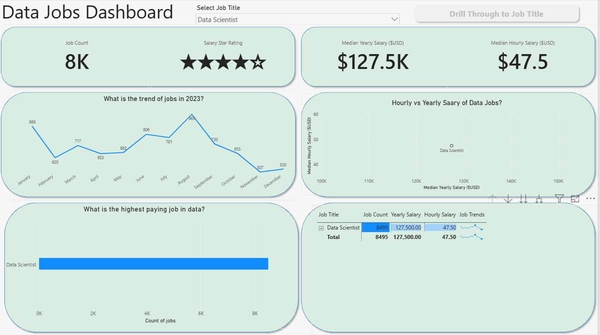
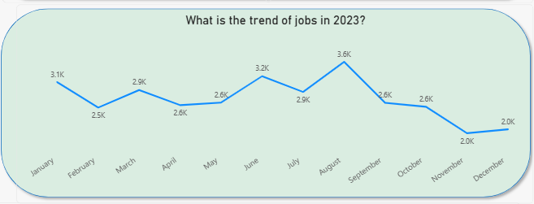
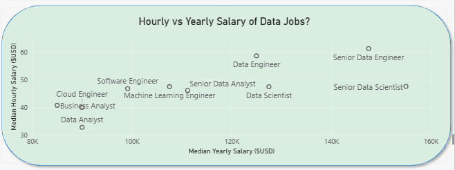
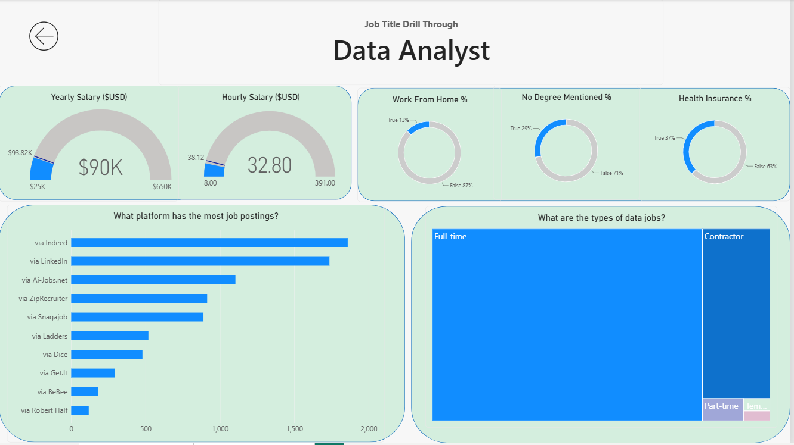
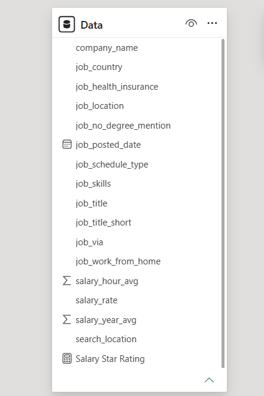
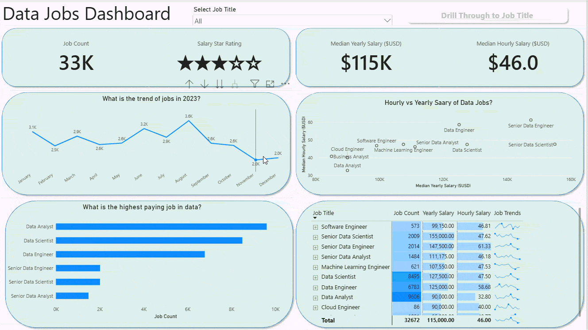

<div align="center">

# 📊 Data Jobs Dashboard

### An interactive Power BI report exploring salaries, job trends, and working conditions across data roles




</div>

---

## 📑 Table of Contents

- [Project Overview](#-project-overview)
- [Business Questions](#-business-questions)
- [Dashboard Preview](#-dashboard-preview)
- [Dataset](#-dataset)
- [Data Model](#-data-model)
- [Key Metrics](#-key-metrics--dax-measures)
- [Key Insights](#-key-insights)
- [Features & Interactivity](#-features--interactivity)
- [Tools & Technologies](#-tools--technologies)
- [How to Use This Project](#-how-to-use-this-project)
- [Author](#-author)

---

## 🎯 Project Overview

This project is an interactive **Power BI dashboard** that analyses the data job market. It helps job seekers and analysts understand **what data roles pay, how demand changed through 2023, where jobs are posted, and what benefits and conditions come with them**.

The report has two pages:

| Page | Purpose |
|------|---------|
| **Data Jobs Dashboard** | High-level overview: salary KPIs, job-posting trend, highest-paying roles, and hourly vs. yearly salary comparison. |
| **Job Title Drill Through** | Detailed view for a single job title: salary gauges, work-from-home %, degree requirements, health insurance, hiring platforms, and job types. |

---

## ❓ Business Questions

The dashboard is built to answer:

1. **What is the highest-paying job in data?**
2. **What is the trend of data job postings in 2023?**
3. **How do hourly and yearly salaries compare across data roles?**
4. **What platform has the most job postings?**
5. **What types of data jobs (schedules) are available?**
6. **How many roles offer remote work, health insurance, or don't require a degree?**

---

## 🎨 Dashboard Preview

### Page 1 — Data Jobs Dashboard

**Includes:** job-title slicer, KPI cards (job title, average yearly salary, average hourly salary, salary star rating), line chart of job-posting trend in 2023, bar chart of highest-paying roles, scatter plot of hourly vs. yearly salary, and a summary table.


<div align="center">
KPI CARDS
</div>
  

<div align="center">
Jobs Trend over time
</div>


<div align="center">
Salary Scatter
</div>


### Page 2 — Job Title Drill Through



**Includes:** yearly and hourly salary gauges, work-from-home %, no-degree-mentioned %, health-insurance %, platform bar chart (`job_via`), and a treemap of job schedule types.

### Data Model

<!-- 📸 IMAGE 5 — DATA MODEL VIEW
     Power BI Desktop → Model view → screenshot.
     File: assets/images/data-model.png -->


### Demo




---

## 📂 Dataset

| Item | Details |
|------|---------|
| **Main table** | `Data` |
| **Source** | Luke Barousse Data Jobs dataset
| **Period** | 2023 job postings |
| **Granularity** | One row per job posting |

**Key fields used**

| Column | Description |
|--------|-------------|
| `job_title_short` | Standardised job title (e.g., Data Analyst, Data Scientist) |
| `job_posted_date` | Date the job was posted |
| `salary_year_avg` | Average yearly salary (USD) |
| `salary_hour_avg` | Average hourly salary (USD) |
| `job_schedule_type` | Full-time, part-time, contract, etc. |
| `job_via` | Platform the job was posted on |
| `job_work_from_home` | Whether the job allows remote work |
| `job_no_degree_mention` | Whether the posting omits a degree requirement |
| `job_health_insurance` | Whether the posting mentions health insurance |

---

## 🧩 Data Model

The model contains the `Data` fact table and a `Salary_Dashboard` table for report measures. Visuals are driven by `job_title_short`, which also powers the page-level slicer and the drill-through.

---

## 🧮 Key Metrics & DAX Measures

| Metric | Description |
|--------|-------------|
| **Average Yearly Salary** | Average of `salary_year_avg` |
| **Average Hourly Salary** | Average of `salary_hour_avg` |
| **Salary Star Rating** | Custom measure that converts salary into a star-style rating card |
| **Job Count** | Count of job postings per title / month |
| **Work From Home %** | Share of postings that allow remote work |
| **Health Insurance %** | Share of postings that mention health insurance |
| **No Degree Mentioned %** | Share of postings with no degree requirement |


---

## 💡 Key Insights


- 📈 **Hiring trend:** Postings peaked in *AUGUST* and dipped in *NOVEMBER* during 2023.
- 🌐 **Top platform:** *INDEED* had the most postings.
- 🏠 **Most common data job:** Data Analyst has the most job postings at 9.6K postings
- 🎓 **Median yearly Salary:** $115K
- 🏥 **Median hourly salary:** $46.0

---

## ✨ Features & Interactivity

- **Job title slicer** to filter the whole dashboard
- **Drill-through** from any job title to a dedicated detail page
- **KPI cards** with yearly, hourly, and star-rated salary
- **Navigation buttons** between pages
- **Gauges, donuts, treemap, scatter, line, and bar charts** for varied views
- **Fluent 2 theme** with a custom 1920 × 1080 layout

---

## 🔧 Tools & Technologies

- **Power BI Desktop** (report design, data modelling)
- **DAX** (calculated measures)
- **Power Query** (data cleaning and transformation)

---

## 🚀 How to Use This Project

1. **Clone** the repository
   ```bash
   git clone https://github.com/manuelmuoghalu-prog/Power_bi-projects.git
   ```
2. **Install** [Power BI Desktop](https://powerbi.microsoft.com/desktop/) (free, Windows).
3. **Open** `PowerBi_Project_1.pbix`.
4. If prompted, **refresh** the data or update the data source path.
5. On Page 1, pick a job title in the slicer, or **right-click a title → Drill through → Job Title Drill Through**.

---


---

## 👤 Author

**Emmanuel Muoghalu**
Mechanical / Design Engineer | Data Analyst

- 🐙 GitHub: Emmanuel Muoghalu (https://github.com/manuelmuoghalu-prog)
- 📧 Email: manuelmuoghalu@gmail.com

---

<div align="center">

⭐ If you found this project useful, please consider giving it a star!

</div>
